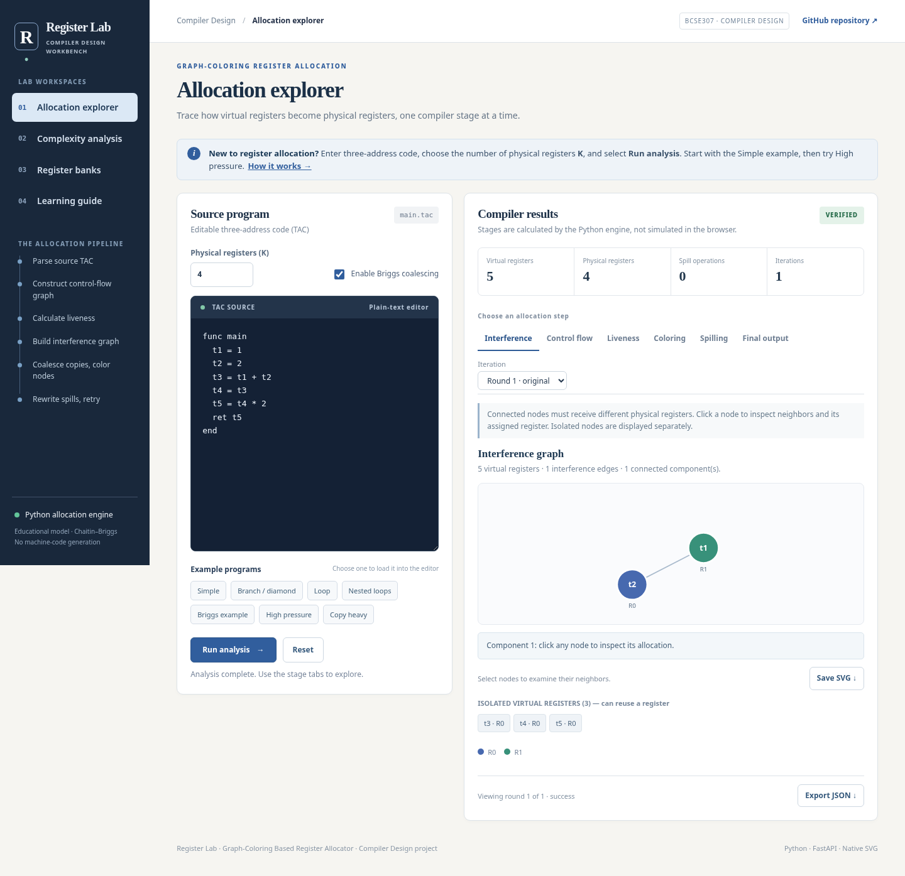

# Register Lab

**A graph-coloring register allocator and interactive Compiler Design workbench**

[](https://graph-coloring-register-allocator.vercel.app/)

> 🌐 **Live Demo:** [https://graph-coloring-register-allocator.vercel.app/](https://graph-coloring-register-allocator.vercel.app/)

Register Lab is an educational implementation of Chaitin–Briggs graph-coloring register allocation for one function written in three-address code (TAC). It builds a control-flow graph (CFG), solves liveness data flow, creates an interference graph, coalesces safe moves, assigns physical registers, and inserts stack spills when required.

The project contains a **working Python compiler core**, **FastAPI endpoints**, and a **self-contained website**. Graphs are drawn as native browser SVG—no Graphviz server, CDN, D3, or remote JavaScript is required.



## What you can explore

| Workspace | What it teaches |
|---|---|
| **Allocation explorer** | Run editable TAC, inspect interference and CFG diagrams, view instruction-level liveness, walk the coloring stack, explore spill rewrites, check the resulting program, and save SVG / JSON |
| **Complexity analysis** | Measure wall-clock time and peak traced Python memory while varying K; independently study measured time and space versus synthetic program size; export CSV |
| **Register banks** | Group physical registers into boxes of 2, 4, or 8 and inspect virtual-to-physical mappings |
| **Learning guide** | A simple four-step walkthrough, TAC grammar examples, pipeline explanations, and limits of the educational model |

**Important distinctions:** Liveness of the **original TAC** does not change merely because K changes. Later spill-rewritten iterations can have different liveness. Register banks are **visual groups**, not hardware memory segmentation. Complexity charts describe allocator overhead, **not** the runtime of compiled code or a proof of Big-O complexity.

## Quick start

Python **3.11 or newer** recommended (CI covers 3.11–3.13).

**Windows PowerShell:**

```powershell
py -m venv .venv
.\.venv\Scripts\Activate.ps1
python -m pip install -r requirements.txt
python -m pytest -q
python scripts/dev_server.py
```

**Linux / macOS:**

```bash
python3 -m venv .venv
source .venv/bin/activate
python -m pip install -r requirements.txt
python -m pytest -q
python scripts/dev_server.py
```

Open **http://127.0.0.1:8000** and choose **Simple → Run analysis**. No API key or external web services are needed.

## Guided demo

1. Open **Allocation explorer** and select **Simple**. Observe the interference graph and the isolated variables below it.
2. Choose **Liveness** to inspect values live before and after individual TAC instructions. The block-level IN and OUT values can still be empty for a straight-line block.
3. Load **High pressure** and set K=2. Switch through allocation iterations to see the spill rewrite and eventual register assignments.
4. Load **Copy heavy** at K=2. The ordinary retry heuristic may fail to converge, but an intentionally conservative final strategy can complete the allocation by inserting extra memory operations. See the warning under **Final output**.
5. Go to **Complexity analysis**. Run Experiment A to vary the register budget; run Experiment B to vary the input size. Interpretation and limitations are described beside the charts.
6. Open **Register banks** to inspect R0–R(K−1) arranged into groups.

For supported TAC syntax, open **Learning guide** in the website or see [`docs/USER_GUIDE.md`](docs/USER_GUIDE.md).

## Compiler pipeline

```text
TAC source
    ↓  recursive-descent parser
basic blocks and control-flow graph
    ↓  backward liveness fixed point
interference graph + copy candidates
    ↓  Briggs conservative coalescing
simplify → select → bounded exact fallback for small graphs
    ├── success → register mapping
    └── spill → insert loads/stores → rebuild CFG and retry
                  ↓
        conservative full live-range spill fallback, if needed (K ≥ 2)
                  ↓
            verification and final TAC
```

The conservative spill fallback is **not** an optimal register allocator. It intentionally favors finishing the educational allocation over minimizing memory traffic. Cases with K=1 and two-operand instructions may still be infeasible; the pipeline returns an explicit retry-limit state rather than inventing a solution.

The reference TAC interpreter compares the return values before and after spill rewriting for terminating programs within a bounded instruction limit. This **does not** prove machine-code correctness; no machine-code backend or target-ISA register constraints are implemented.

## Project layout

```text
api/                 FastAPI allocation, register-budget and input-size experiments
src/frontend/        TAC tokenizer/parser and CFG
src/analysis/        Liveness, interference, bounded reference interpreter
src/colouring/       Briggs coalescing, simplify/select, DSATUR fallback
src/spilling/        Spilling, rewriting and retry pipeline
src/metrics.py       Shared allocation metrics
public/              Standalone website, styles and local SVG renderer
public/examples/     Browser-loadable TAC examples (bundled for deployment)
benchmarks/          Benchmark fixture source files
scripts/             CLI/web server, profiling and benchmark commands
tests/               Unit, randomized-semantic, API and release regression tests
docs/                Architecture, guided usage, academic review materials
.github/workflows/   Python test workflow
```

## Commands and API

```bash
python -m src.cli --help
python scripts/run_benchmarks.py
python scripts/profile_allocator.py --repeat 7 --output allocator_profile.csv
```

Endpoints exposed by the FastAPI app:

- `POST /api/analyze` — `{ "code": "func main\n t1 = 1\n ret t1\nend", "k": 4, "coalescing": true }`
- `POST /api/experiment` — `{ "code": "...", "register_counts": [2,3,4,6,8], "repeats": 3, "coalescing": true }`
- `POST /api/scale-study` — `{ "sizes": [16,32,64,96,128], "k": 4, "repeats": 2 }`

Public demo endpoints have size limits to bound compute work. Program code must be valid custom TAC; this is not a general C, Java or Python compiler.

## Deploy on Vercel

1. Push the *contents* of this folder to your GitHub repository (not the enclosing ZIP file).
2. Go to Vercel → **Add New Project**, import that repository, and use the repository root as the project root.
3. Deploy using Vercel's supported Python/FastAPI functions and static `public/` content. The project supplies `api/index.py` and `vercel.json`.
4. Verify the landing page, `POST /api/analyze`, `POST /api/experiment`, `POST /api/scale-study`, and `/examples/simple.tac` on the deployment domain.
5. Run the **Simple**, **Diamond**, **High pressure** and **Copy heavy** examples in the deployed browser. If a route fails, inspect your deployment's serverless function logs before changing routing.

**Live deployment:** [https://graph-coloring-register-allocator.vercel.app/](https://graph-coloring-register-allocator.vercel.app/)

## Tests and reproducibility

```bash
python -m pytest -q
node --check public/script.js  # optional: requires Node.js
```

Tests cover parsing, CFG, liveness, interference, coalescing, spilling, interpreter equivalence, API responses, and complexity-study validation. Python 3.11–3.13 test runs are configured in GitHub Actions. See [`docs/FINAL_RELEASE.md`](docs/FINAL_RELEASE.md) for tested behavior and known limits.

## Academic scope and references

This project follows the aims of the attached **Review 1 (Initial Design, Planning & Feasibility)** and **Review 2 (Implementation, Testing & Deployment)**. The reviews are included in `docs/reviews/`.

Background: Chaitin (1982), Briggs, Cooper & Torczon (1994), George & Appel (1996), and Aho et al., *Compilers: Principles, Techniques, and Tools* (2nd ed.).

**Repository:** [Graph-Coloring-Register-Allocator](https://github.com/ShantanuSaurav/Graph-Coloring-Register-Allocator)
